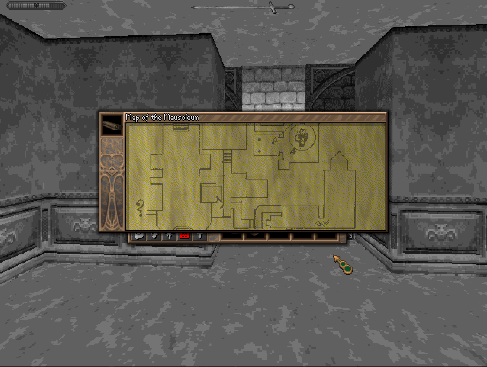
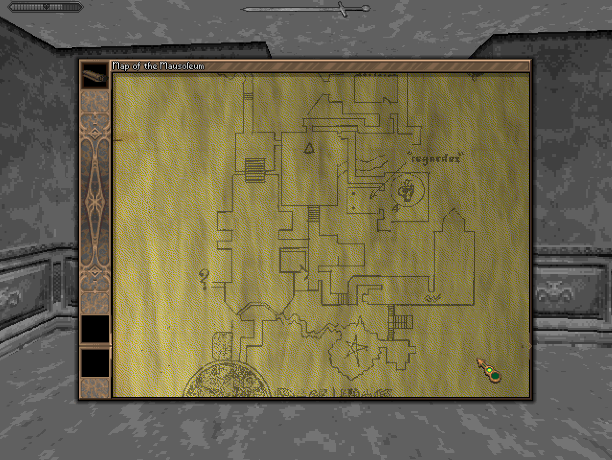

# Document Viewer

A mod for **[ROTH.C](https://github.com/beyond-the-ire/ROTH.C)** that increases the size of the docment inspect window, allowing more of the documents and maps to be visible.

## What it does

When you inspect a document (or another close-up item) from your inventory, the game opens a small
pop-up modal to show it. That pop-up is a fixed size inherited from the original 320x200 era, so in
the game's high-resolution display modes it's really small. This mod enlarges it (125% wider and
225% taller by default), re-centers it on screen, and repairs the side-frame artwork so the
taller box tiles cleanly instead of showing garbage along its edges.

Note about the tiled texture/artwork: it's not 100% perfect, because it's meant for a fixed
frame size, but I feel like this solution is good enough without requiring modified textures.
See the screenshot below to see how it looks.

The enlargement takes effect only in the game's **high-resolution (640-wide) display modes**. In the
low-resolution modes the pop-up is left exactly as the original drew it, and when the mod is disabled
it is left untouched everywhere.

Before:


After:


## Install

Extract the mod so its folder lands in the game's `mods/` directory:

```
<game>/mods/doc_viewer/plugin.so
<game>/mods/doc_viewer/doc_viewer.cfg
```

Both files must sit together in `mods/doc_viewer/`.

## Configuration

`doc_viewer.cfg` has three settings:

| setting   | default   | meaning                                                                                                                                                                                                                    |
| --------- | --------- | -------------------------------------------------------------------------------------------------------------------------------------------------------------------------------------------------------------------------- |
| `enabled` | `1`       | Master switch. When `0` the inspect pop-up is left as the original.                                                                                                                                                        |
| `scale`   | `125x225` | Enlarged size as a percentage (width × height) of the largest box that fits the view. A single number sets both. Range 100-400; the box is only ever grown, never shrunk.                                                  |
| `side_h`  | `150,150` | Safe source height, in pixels, of the tiled left,right frame columns. A single number sets both. Kept under the artwork's true height so the frame never reads past its own art — change it only for custom frame sprites. |

### Optional environment overrides (these win over the cfg)

- `ROTH_DOC_VIEWER=0|1` - master switch
- `ROTH_DOC_VIEWER_SCALE="125x225"` - enlarged size percent
- `ROTH_DOC_VIEWER_SIDE_H="150,150"` - safe side-column source height

## Disabling / removing

- Set `enabled = 0` in `doc_viewer.cfg` (the pop-up reverts to the original).
- Delete the `mods/doc_viewer/` folder to remove it entirely.
- Launch with `--no-mods` (or `ROTH_MODS=0`) to disable all mods at once.
