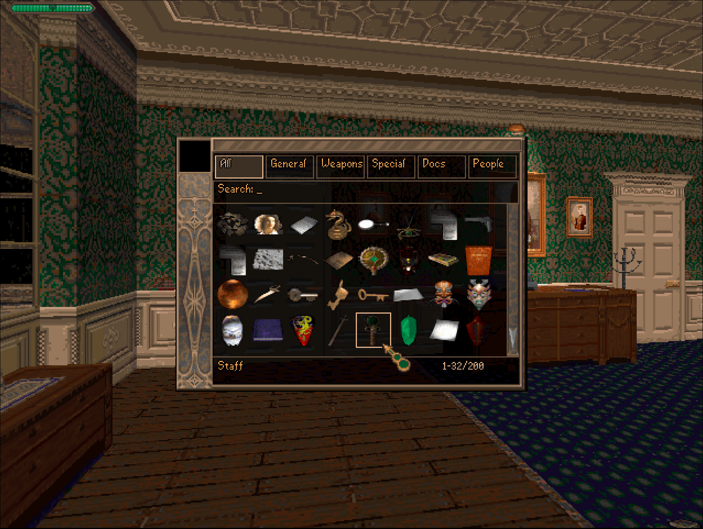

# Item Grabber

An F7 overlay mod for **[ROTH.C](https://github.com/beyond-the-ire/ROTH.C)** that grants any inventory item with a click. A cheat / dev tool.

## What it does

Press **F7** in game to open an item browser window. Click any item and it gets added
straight to your inventory. The whole browser is drawn on top of the running game and nothing in the
game itself is modified.

It only opens while you are actually in-game and not in menus or cutscenes.



## Controls

- **F7** - open / close the overlay (**Esc** also closes)
- **Left-click an item** - add the item to player inventory
- **Hover an item** - its name shows in the bottom bar
- **Click a tab** - filter by category: All, General, Weapons, Special, Docs, People
- **Just type** - live-search by name; **Backspace** edits the text
- **Click the up/down arrows** - scroll up/down one row at a time
- **`[`or `]`** - scroll up/down by whole pages

## Install

Extract the mod so its folder lands in the game's `mods/` directory:

```
<game>/mods/item_grabber/plugin.so
<game>/mods/item_grabber/item_grabber.cfg
```

Both files must sit together in `mods/item_grabber/`.

## Configuration

`item_grabber.cfg` has two settings:

| setting   | default | meaning                                                                                                       |
| --------- | ------- | ------------------------------------------------------------------------------------------------------------- |
| `enabled` | `1`     | Master switch. `0` turns the tool off (as does a missing cfg file).                                           |
| `key`     | `f7`    | Open/close key — any key name from the keybinds vocabulary (`a`–`z`, `f1`–`f10`, …) or a raw `0xNN` scancode. |

Because it is a cheat tool it ships enabled; set `enabled = 0` if you want it installed but dormant.

### Optional environment overrides

All optional, for tuning:

- `ROTH_ITEM_GRABBER=0|1` - master switch (overrides the cfg)
- `ROTH_ITEM_GRABBER_SENS=<n>` - cursor sensitivity
- `ROTH_ITEM_GRABBER_PANEL=WxH` - panel size as a percent of the screen
- `ROTH_ITEM_GRABBER_DIM=N|NxP|off` - how much to dim the game behind the panel
- `ROTH_ITEM_GRABBER_TEXT_COLOR=N`, `ROTH_ITEM_GRABBER_ACCENT_COLOR=N` - palette-index colours
- `ROTH_ITEM_GRABBER_FRAME=0` - drop the ornate frame (`_FRAME_BG=N`, `_SPINE_MIRROR=0` tune it)
- `ROTH_ITEM_GRABBER_OPEN=1` - allow opening outside normal play (dev)

## Disabling / removing

- Set `enabled = 0` in `item_grabber.cfg` (or `ROTH_ITEM_GRABBER=0`).
- Delete the `mods/item_grabber/` folder to remove it entirely.
- Launch with `--no-mods` (or `ROTH_MODS=0`) to disable all mods at once.

---

Requires the ROTH.C moddable engine.
